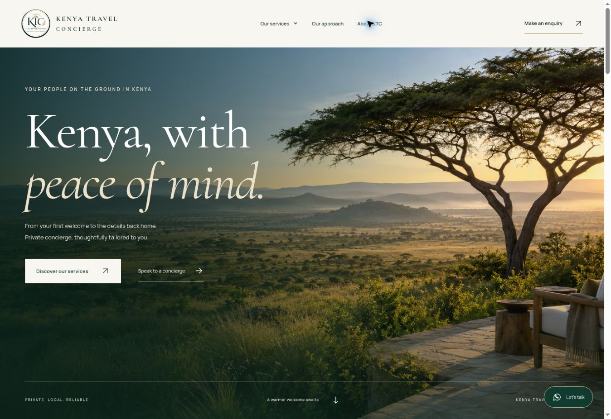

# Kenya Travel Concierge

A premium, responsive static website for Kenya Travel Concierge. Built with HTML, CSS, and vanilla JavaScript; no runtime framework or database required.



## Website

- Homepage with original Kenyan landscape imagery and the supplied KTC identity.
- Service catalogue with three category filters and ten dedicated service pages.
- Visitor journeys for guests, people relocating, and Kenyans abroad.
- WhatsApp and email enquiry preparation, including service selection and browser validation.
- Mobile navigation, keyboard-accessible tabs, FAQ disclosures, reduced-motion support, metadata, sitemap, and privacy information.

## Run and edit

The ready-to-upload website starts at `index.html` in this folder. A parallel built copy remains in `dist/`. Serve the project folder to preview it. For example:

```sh
python3 -m http.server 8080
```

Edit service descriptions and inclusions in `data/services.json`. Shared page templates and general copy are in `scripts/build.py`; styles and interactions are in `dist/assets/styles.css` and `dist/assets/app.js`. Rebuilding also copies the updated website and assets to the project root for GitHub Pages.

Regenerate the HTML and check links:

```sh
python3 scripts/build.py
python3 scripts/check.py
python3 scripts/check_seo.py
node --check dist/assets/app.js
```

Python 3.10+ is needed only for regeneration. Node is used only for the optional JavaScript syntax check. The published site needs neither.

## Hosting on GitHub Pages

This export is prepared for `collinsiswerve/kenya-travel-concierge`.

1. Extract the ZIP and upload all extracted files and folders directly into the repository on `main`. The repository must show `index.html` next to `README.md`, not inside an extra outer folder.
2. Open **Settings > Pages**.
3. Set **Source: Deploy from a branch**, **Branch: main**, and **Folder: /(root)**. Save if the settings changed.
4. After the Pages deployment succeeds, open **Visit site** or `https://collinsiswerve.github.io/kenya-travel-concierge/`.

See `UPLOAD_GUIDE.txt` for the complete browser upload steps. No custom Actions workflow or build command is required on GitHub. The included `.nojekyll` file selects static publishing. Navigation, stylesheets and font URLs support the GitHub project address; canonical and sitemap URLs use that address as well.

If publishing at a different URL, set `SITE_URL` to its complete public base URL when rebuilding. The `404.html` navigation uses this base URL so it also works at missing nested routes.

The `.openai/hosting.json` file retains the original connected Sites project identity and still points to `dist/`. Preserve it when updating that Site. GitHub Pages serves the ready copy at the repository root.

## Search visibility and performance

See [SEO readiness and launch plan](docs/SEO_READINESS.md) for implemented checks and the remaining Google account steps. Business details, the canonical base URL and an optional Search Console verification value are in `data/site.json`. The homepage uses an optimized WebP and all active font URLs use WOFF2; the source assets and licences are retained. `scripts/optimize_assets.py` regenerates those optimized files when its optional development libraries are installed. HTML rebuilding and hosting require no extra packages.

## Enquiries

The form prepares a message locally and opens WhatsApp or the visitor's email app. It does not silently send messages or store requests in a site database. Visitors review and send their message themselves. Phone: +254 717 762323. Email: info.kenyatravelconcierge@gmail.com.

## Assets

The logo and supporting brand imagery come from the owner's supplied WhatsApp catalogue screenshots. The original screenshot files remain unchanged; CSS presents only the relevant logo or image region. The photographs within the supplied brand artwork are used as promotional illustrations, not as verified staff or property photographs.

The savannah hero is an original AI-generated illustrative brand image, created with the built-in image-generation tool. The generation brief is in `data/hero-prompt.txt`. It is not a photograph of a named property or a specific offered itinerary.

Cormorant Garamond and Manrope are self-hosted Google Fonts. Their SIL Open Font License notices are included in `dist/assets/`. The reference website informed the spacious editorial presentation; its code, photographs, copy, awards, and testimonials have not been copied.

## Ownership

Brand content and supplied imagery remain subject to their respective owners' rights. This repository is intended for Kenya Travel Concierge's website. No broad open-source licence is asserted over the brand or supplied images.
